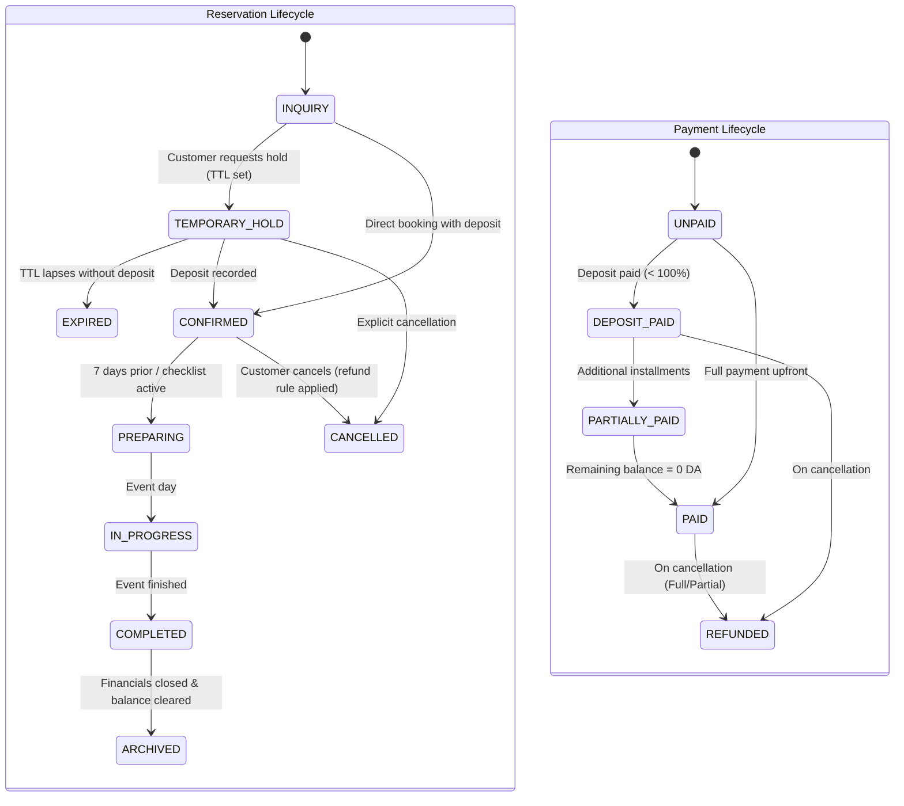

# Phase 1: Requirements Analysis & Specification
**Project:** Algerian Wedding Hall Management System (*Système de Gestion de Salle des Fêtes*)  
**Architecture Target:** Modular Monolith (Laravel 11 + PostgreSQL + Blade/Alpine/Tailwind or Vanilla CSS + PDF generator)  
**Primary Market:** Algeria (Currency: DZD / DA, Timezone: `Africa/Algiers`, Languages: French & Arabic RTL)

---

## 1. Actors & Access Boundaries (RBAC)

The system uses standard role-based access control with 5 roles. A multi-tenant discriminator (`business_id`) is attached to all tenant-scoped tables from Day 1 to ensure zero-refactor migration to SaaS in Version 3.

| Role | Scope & Permissions | Key Interfaces |
| :--- | :--- | :--- |
| **OWNER** | Full root access: financial aggregates, profit margins, audit trail, staff compensation rates, business settings, cancellation policy overrides, cash register lock/unlock. | Executive Dashboard, Full Financials, Audit Logs, Settings |
| **MANAGER** | Operational management: approve holds, convert quotes, assign staff/suppliers, manage packages/menus, oversee calendar and day-of readiness. | Calendar, Reservations, Event Operations, Staff Assignments |
| **RECEPTIONIST** | Front-desk operations: instantaneous availability lookups, customer intake, create temporary holds, draft quotes, log initial deposits, print vouchers & receipts. Restricted from deleting payments or modifying closed events. | Quick Availability Grid, Customer Form, Fast Reservation Modal, Receipts |
| **ACCOUNTANT** | Financial operations: log milestone payments, track unpaid balances, register event-specific & overhead expenses, supplier payouts, close daily cash register. | Payments, Invoices, Daily Cash Register, Expense Ledger |
| **EVENT_COORDINATOR** | Logistics & execution: execute preparation checklists, verify kitchen/equipment allocations, monitor temporary staff headcounts on event day, flag damaged inventory. | Event File, Prep Checklist, Kitchen Sheet, Task Board |

---

## 2. Core Business Workflow & State Machines

### 2.1 The Two Decoupled State Machines

To prevent state corruption, **Reservation Status** and **Payment Status** are strictly independent:

### 2.2 Date & Time Slot Rules (Zero Overlap)

1. **Space Granularity:** Overlap checks apply per physical space (`venue_space_id`), not per venue. A venue with *Salle Royale* and *Salle Andalouse* can host concurrent events.
2. **Time Window Collision Logic:**
   Two reservations $A$ and $B$ for the same `venue_space_id` on the same `event_date` collide if and only if:
   $$\max(A.\text{start\_time}, B.\text{start\_time}) < \min(A.\text{end\_time}, B.\text{end\_time})$$
   Excluding reservations where `status = 'CANCELLED'` or `status = 'EXPIRED'`.
3. **Turnaround / Cleaning Buffer:** System can optionally enforce a configurable turnaround buffer (e.g., 60 minutes) between slots (e.g., Afternoon 14:00–18:00 vs Evening 19:30–02:00).
4. **Temporary Hold Expiration:** A cron job/scheduled worker marks reservations whose `hold_expires_at <= NOW()` as `EXPIRED`, immediately releasing the visual slot while preserving customer inquiry history.

---

## 3. High-Priority Use Cases

### UC-01: 5-Second Phone Availability Check (Receptionist)
- **Goal:** Answer a phone inquiry instantly without opening multiple pages.
- **Workflow:** 
  1. Receptionist opens `/availability` (accessible via hotkey `Alt+A` or prominent top bar button).
  2. Selects date (defaults to today or next weekend).
  3. UI returns matrix of all spaces with daytime/evening/custom slots colored green (Free), yellow (Temporary Hold with expiration countdown), or red (Booked).
  4. One click on an open slot opens the **Quick Booking Modal**.

### UC-02: Fast Reservation & Deposit Intake (< 60 seconds)
- **Goal:** Lock a reservation and issue a stamped PDF receipt while the client is sitting at reception.
- **Workflow:**
  1. Pick Space, Date, and Time Slot.
  2. Search existing Customer by Phone number; if missing, create inline with minimal required fields (Full Name, Phone, Wilaya).
  3. Select Event Type (*Mariage, Fiançailles, etc.*), Bride & Groom names, expected guest count.
  4. Select Base Package or enter Custom Flat Price.
  5. Choose status: `TEMPORARY_HOLD` (pick TTL e.g. 24h/48h) or `CONFIRMED` (requires Deposit payment record).
  6. If deposit paid: record amount (e.g., `100,000 DA`), payment method (`CASH`, `CHEQUE`, `TRANSFER`), and generate immediate printable PDF receipt.

### UC-03: Event Profitability Calculation
- **Goal:** Real-time net margin visibility per wedding.
- **Formula:**
  $$\text{Net Margin (DA)} = \text{Total Agreed Price} - \left( \sum \text{Direct Expenses} + \sum \text{Assigned Staff Wages} + \sum \text{External Supplier Fees} \right)$$
- **Enforcement:** Expenses tagged with `reservation_id` auto-update the event file's margin badge.

### UC-04: Click-to-WhatsApp Engagement (No Cost, No Complex API)
- **Goal:** Send formatted Arabic/French booking confirmations and payment reminders with zero API subscription cost.
- **Implementation:** Deep-link button generating `https://wa.me/213{phone}?text={encoded_message}`.
  - Template examples: Confirmation de réservation, Rappel du solde restant, Fiche de visite.

---

## 4. MVP Scope Definition (V1 vs Deferred)

Following the **Ponytail (lazy & lean)** principle, we ruthlessly cut speculative features that wedding hall owners do not need on Day 1.

| Module | In MVP (Version 1) | Deferred to Version 2 | Deferred to Version 3 (SaaS) |
| :--- | :--- | :--- | :--- |
| **Authentication & RBAC** | Session auth, 5 roles, database permissions, multi-tenant `business_id` prep. | 2FA, granular custom permission builder. | Social login, team invitations. |
| **Venues & Spaces** | Multi-space management, custom time slots, capacity limits. | Space floor maps (static image upload). | Multi-venue enterprise chaining. |
| **Calendar & Availability** | Fast lookup grid, Month/Week/Day agenda, color-coded statuses, overlap validation. | iCal export/sync with Google Calendar. | Public embeddable booking calendar. |
| **Reservations & Holds** | Lifecycle state machine, TTL expiration, bride/groom fields, guest headcount history. | Online reservation request forms. | Self-service client portal. |
| **Pricing & Quotations** | Base hall price, per-person rates, package catalog, custom line items, PDF quotation generator (FR/AR). | Seasonal auto-surges, dynamic discount coupons. | Dynamic pricing AI. |
| **Payments & Cashflow** | Installments ledger, balance tracking, PDF receipts with Algerian legal format, Daily Cash Register closing. | Bank reconciliation, partial cheque tracking. | Online payment gateways (CIB / Edahabia). |
| **Contracts** | Fillable contract template with variables (`{client_name}`, `{date}`, `{amount}`, `{rules}`), PDF export. | Digital signature tablet capture. | Legally binding e-signature integration. |
| **Event Execution** | Reusable checklists (7 days prior, 1 day prior, wedding day), basic catering menu selector, kitchen prep quantities sheet. | Visual drag-drop table seating planner. | Mobile coordinator native app. |
| **Suppliers & Staff** | Supplier directory, event staff headcount assignment, flat wage expense recording. | Automated supplier payment schedules, staff check-in clock. | Full payroll & HR module. |
| **Inventory & Equipment** | Basic stock list with allocation conflict warnings for high-value items (chairs, tables, sound). | Barcode/QR asset scanning, supplier rentals. | Automated warehouse replenishment. |
| **Languages & Region** | French & Arabic RTL, DZD currency formatting, 58 Algerian Wilayas + Communes lookup table. | English language UI. | Multi-country regional settings. |

---

## 5. Architectural Guarantees for Single Developer Maintainability

1. **Technology:** Laravel 11, PostgreSQL, Blade + Tailwind CSS + Alpine.js, DomPDF / Browsershot for PDF generation.
2. **No Unneeded Dependencies:**
   - No external microservice dependencies.
   - WhatsApp handled via native URI schemes (`wa.me`).
   - Clean Service Layer for complex business logic (e.g. `ReservationBookingService`, `AvailabilityService`, `FinancialLedgerService`).
   - Decimal/Numeric types (`NUMERIC(12, 2)`) for every monetary column—never floats.
3. **Database Integrity:** PostgreSQL range exclusion constraints or transactional pessimistic locking (`SELECT ... FOR UPDATE`) to guarantee impossible double-bookings even under concurrent browser tabs.
