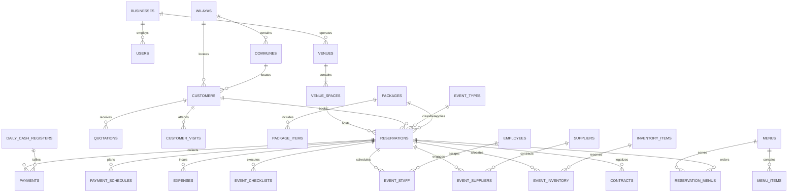

# Phase 2: Database Architecture & PostgreSQL Schema
**Project:** Algerian Wedding Hall Management System  
**RDBMS:** PostgreSQL 15+ (with `btree_gist` extension for zero-overlap constraints)  
**Conventions:** Snake_case tables/columns, explicit `NUMERIC(12,2)` for Algerian Dinar (`DA`), UTC/`Africa/Algiers` timestamptz.

---

## 1. Entity Relationship Overview



---

## 2. PostgreSQL DDL & Table Specifications

### 2.1 Geographic & Multi-Tenancy Core

```sql
-- Enable extension for temporal interval conflict prevention
CREATE EXTENSION IF NOT EXISTS "uuid-ossp";
CREATE EXTENSION IF NOT EXISTS "btree_gist";

-- Algerian Administrative Geography (58 Wilayas)
CREATE TABLE wilayas (
    id SMALLINT PRIMARY KEY,
    code VARCHAR(3) NOT NULL UNIQUE,
    name_fr VARCHAR(100) NOT NULL,
    name_ar VARCHAR(100) NOT NULL
);

CREATE TABLE communes (
    id SERIAL PRIMARY KEY,
    wilaya_id SMALLINT NOT NULL REFERENCES wilayas(id) ON DELETE RESTRICT,
    name_fr VARCHAR(120) NOT NULL,
    name_ar VARCHAR(120) NOT NULL,
    postcode VARCHAR(10)
);

CREATE INDEX idx_communes_wilaya ON communes(wilaya_id);

-- Business Entity (Hall Operator / Tenant)
CREATE TABLE businesses (
    id UUID PRIMARY KEY DEFAULT uuid_generate_v4(),
    name_fr VARCHAR(150) NOT NULL,
    name_ar VARCHAR(150) NOT NULL,
    slug VARCHAR(100) NOT NULL UNIQUE,
    phone VARCHAR(30) NOT NULL,
    whatsapp VARCHAR(30),
    email VARCHAR(150),
    wilaya_id SMALLINT REFERENCES wilayas(id) ON DELETE SET NULL,
    commune_id INTEGER REFERENCES communes(id) ON DELETE SET NULL,
    address_line TEXT,
    nif VARCHAR(30),
    nis VARCHAR(30),
    rc VARCHAR(30),
    logo_path VARCHAR(255),
    currency VARCHAR(5) NOT NULL DEFAULT 'DZD',
    timezone VARCHAR(50) NOT NULL DEFAULT 'Africa/Algiers',
    settings JSONB NOT NULL DEFAULT '{}'::jsonb,
    is_active BOOLEAN NOT NULL DEFAULT true,
    created_at TIMESTAMPTZ NOT NULL DEFAULT NOW(),
    updated_at TIMESTAMPTZ NOT NULL DEFAULT NOW()
);
```

### 2.2 RBAC & Audit Trails

```sql
CREATE TYPE user_role AS ENUM (
    'OWNER',
    'MANAGER',
    'RECEPTIONIST',
    'ACCOUNTANT',
    'EVENT_COORDINATOR'
);

CREATE TABLE users (
    id UUID PRIMARY KEY DEFAULT uuid_generate_v4(),
    business_id UUID NOT NULL REFERENCES businesses(id) ON DELETE CASCADE,
    name VARCHAR(150) NOT NULL,
    email VARCHAR(150) NOT NULL,
    phone VARCHAR(30),
    password VARCHAR(255) NOT NULL,
    role user_role NOT NULL DEFAULT 'RECEPTIONIST',
    preferred_language VARCHAR(5) NOT NULL DEFAULT 'fr',
    is_active BOOLEAN NOT NULL DEFAULT true,
    remember_token VARCHAR(100),
    created_at TIMESTAMPTZ NOT NULL DEFAULT NOW(),
    updated_at TIMESTAMPTZ NOT NULL DEFAULT NOW(),
    CONSTRAINT uq_users_business_email UNIQUE (business_id, email)
);

CREATE TABLE audit_logs (
    id BIGSERIAL PRIMARY KEY,
    business_id UUID NOT NULL REFERENCES businesses(id) ON DELETE CASCADE,
    user_id UUID REFERENCES users(id) ON DELETE SET NULL,
    action VARCHAR(50) NOT NULL, -- CREATE, UPDATE, DELETE, STATUS_CHANGE, LOGIN
    auditable_type VARCHAR(100) NOT NULL,
    auditable_id UUID NOT NULL,
    old_values JSONB,
    new_values JSONB,
    ip_address INET,
    user_agent TEXT,
    created_at TIMESTAMPTZ NOT NULL DEFAULT NOW()
);

CREATE INDEX idx_audit_business_date ON audit_logs(business_id, created_at DESC);
CREATE INDEX idx_audit_entity ON audit_logs(auditable_type, auditable_id);
```

### 2.3 Physical Venues, Spaces & Time Slots

```sql
CREATE TABLE venues (
    id UUID PRIMARY KEY DEFAULT uuid_generate_v4(),
    business_id UUID NOT NULL REFERENCES businesses(id) ON DELETE CASCADE,
    name_fr VARCHAR(150) NOT NULL,
    name_ar VARCHAR(150) NOT NULL,
    address TEXT,
    is_active BOOLEAN NOT NULL DEFAULT true,
    created_at TIMESTAMPTZ NOT NULL DEFAULT NOW(),
    updated_at TIMESTAMPTZ NOT NULL DEFAULT NOW()
);

CREATE TABLE venue_spaces (
    id UUID PRIMARY KEY DEFAULT uuid_generate_v4(),
    venue_id UUID NOT NULL REFERENCES venues(id) ON DELETE CASCADE,
    business_id UUID NOT NULL REFERENCES businesses(id) ON DELETE CASCADE,
    name_fr VARCHAR(150) NOT NULL,
    name_ar VARCHAR(150) NOT NULL,
    capacity_min INTEGER NOT NULL DEFAULT 50,
    capacity_max INTEGER NOT NULL DEFAULT 500,
    base_price NUMERIC(12, 2) NOT NULL DEFAULT 0.00,
    is_active BOOLEAN NOT NULL DEFAULT true,
    created_at TIMESTAMPTZ NOT NULL DEFAULT NOW(),
    updated_at TIMESTAMPTZ NOT NULL DEFAULT NOW(),
    CONSTRAINT chk_space_capacity CHECK (capacity_max >= capacity_min)
);

CREATE TABLE time_slots (
    id UUID PRIMARY KEY DEFAULT uuid_generate_v4(),
    business_id UUID NOT NULL REFERENCES businesses(id) ON DELETE CASCADE,
    name_fr VARCHAR(100) NOT NULL, -- e.g. 'Après-midi', 'Soirée'
    name_ar VARCHAR(100) NOT NULL, -- e.g. 'مساء', 'سهرة'
    default_start_time TIME NOT NULL,
    default_end_time TIME NOT NULL,
    is_overnight BOOLEAN NOT NULL DEFAULT false,
    sort_order SMALLINT NOT NULL DEFAULT 1,
    is_active BOOLEAN NOT NULL DEFAULT true
);
```

### 2.4 Customers, Prospects & Visits

```sql
CREATE TYPE acquisition_channel AS ENUM (
    'FACEBOOK',
    'INSTAGRAM',
    'TIKTOK',
    'GOOGLE',
    'RECOMMENDATION',
    'WALK_IN',
    'OTHER'
);

CREATE TABLE customers (
    id UUID PRIMARY KEY DEFAULT uuid_generate_v4(),
    business_id UUID NOT NULL REFERENCES businesses(id) ON DELETE CASCADE,
    customer_code VARCHAR(30) NOT NULL,
    full_name VARCHAR(150) NOT NULL,
    phone VARCHAR(30) NOT NULL,
    second_phone VARCHAR(30),
    whatsapp_number VARCHAR(30),
    email VARCHAR(150),
    wilaya_id SMALLINT REFERENCES wilayas(id) ON DELETE SET NULL,
    commune_id INTEGER REFERENCES communes(id) ON DELETE SET NULL,
    address_line TEXT,
    bride_name VARCHAR(120),
    groom_name VARCHAR(120),
    preferred_language VARCHAR(5) NOT NULL DEFAULT 'fr',
    source acquisition_channel NOT NULL DEFAULT 'WALK_IN',
    internal_notes TEXT,
    created_at TIMESTAMPTZ NOT NULL DEFAULT NOW(),
    updated_at TIMESTAMPTZ NOT NULL DEFAULT NOW(),
    CONSTRAINT uq_customer_business_code UNIQUE (business_id, customer_code)
);

CREATE INDEX idx_customers_phone ON customers(business_id, phone);
CREATE INDEX idx_customers_name ON customers(business_id, full_name);

CREATE TYPE lead_status AS ENUM (
    'NEW',
    'CONTACTED',
    'VISIT_SCHEDULED',
    'VISITED',
    'QUOTE_SENT',
    'WAITING',
    'RESERVED',
    'LOST'
);

CREATE TABLE customer_leads (
    id UUID PRIMARY KEY DEFAULT uuid_generate_v4(),
    business_id UUID NOT NULL REFERENCES businesses(id) ON DELETE CASCADE,
    customer_id UUID REFERENCES customers(id) ON DELETE SET NULL,
    contact_name VARCHAR(150) NOT NULL,
    phone VARCHAR(30) NOT NULL,
    status lead_status NOT NULL DEFAULT 'NEW',
    desired_date DATE,
    estimated_guests INTEGER,
    estimated_budget NUMERIC(12, 2),
    venue_space_id UUID REFERENCES venue_spaces(id) ON DELETE SET NULL,
    lost_reason VARCHAR(100), -- PRICE, UNAVAILABLE_DATE, CAPACITY, COMPETITOR, NO_RESPONSE, DATE_CHANGED, OTHER
    notes TEXT,
    created_by UUID REFERENCES users(id) ON DELETE SET NULL,
    created_at TIMESTAMPTZ NOT NULL DEFAULT NOW(),
    updated_at TIMESTAMPTZ NOT NULL DEFAULT NOW()
);

CREATE TABLE customer_visits (
    id UUID PRIMARY KEY DEFAULT uuid_generate_v4(),
    business_id UUID NOT NULL REFERENCES businesses(id) ON DELETE CASCADE,
    lead_id UUID REFERENCES customer_leads(id) ON DELETE SET NULL,
    customer_id UUID REFERENCES customers(id) ON DELETE SET NULL,
    venue_space_id UUID NOT NULL REFERENCES venue_spaces(id) ON DELETE CASCADE,
    scheduled_at TIMESTAMPTZ NOT NULL,
    handled_by UUID REFERENCES users(id) ON DELETE SET NULL,
    result VARCHAR(50), -- INTERESTED, FOLLOW_UP, QUOTE_REQUESTED, RESERVED, NOT_INTERESTED
    follow_up_date DATE,
    notes TEXT,
    created_at TIMESTAMPTZ NOT NULL DEFAULT NOW()
);
```

### 2.5 Catalog: Event Types, Packages & Menus

```sql
CREATE TABLE event_types (
    id UUID PRIMARY KEY DEFAULT uuid_generate_v4(),
    business_id UUID NOT NULL REFERENCES businesses(id) ON DELETE CASCADE,
    code VARCHAR(50) NOT NULL, -- WEDDING, ENGAGEMENT, HENNA, AQIQA, BIRTHDAY, SEMINAR, CORPORATE, CUSTOM
    name_fr VARCHAR(100) NOT NULL,
    name_ar VARCHAR(100) NOT NULL,
    icon VARCHAR(50),
    is_active BOOLEAN NOT NULL DEFAULT true
);

CREATE TYPE package_pricing_mode AS ENUM (
    'FIXED',
    'PER_GUEST',
    'FIXED_PLUS_PER_GUEST'
);

CREATE TABLE packages (
    id UUID PRIMARY KEY DEFAULT uuid_generate_v4(),
    business_id UUID NOT NULL REFERENCES businesses(id) ON DELETE CASCADE,
    name_fr VARCHAR(150) NOT NULL,
    name_ar VARCHAR(150) NOT NULL,
    description TEXT,
    pricing_mode package_pricing_mode NOT NULL DEFAULT 'FIXED',
    base_price NUMERIC(12, 2) NOT NULL DEFAULT 0.00,
    price_per_guest NUMERIC(12, 2) NOT NULL DEFAULT 0.00,
    min_guests INTEGER NOT NULL DEFAULT 0,
    max_guests INTEGER NOT NULL DEFAULT 1000,
    is_active BOOLEAN NOT NULL DEFAULT true,
    created_at TIMESTAMPTZ NOT NULL DEFAULT NOW(),
    updated_at TIMESTAMPTZ NOT NULL DEFAULT NOW()
);

CREATE TABLE package_items (
    id UUID PRIMARY KEY DEFAULT uuid_generate_v4(),
    package_id UUID NOT NULL REFERENCES packages(id) ON DELETE CASCADE,
    item_type VARCHAR(50) NOT NULL, -- SERVICE, EQUIPMENT, STAFF, DECORATION, MENU
    title_fr VARCHAR(150) NOT NULL,
    title_ar VARCHAR(150) NOT NULL,
    quantity INTEGER NOT NULL DEFAULT 1,
    sort_order SMALLINT NOT NULL DEFAULT 1
);

CREATE TABLE menus (
    id UUID PRIMARY KEY DEFAULT uuid_generate_v4(),
    business_id UUID NOT NULL REFERENCES businesses(id) ON DELETE CASCADE,
    name_fr VARCHAR(150) NOT NULL,
    name_ar VARCHAR(150) NOT NULL,
    price_per_person NUMERIC(12, 2) NOT NULL,
    cost_per_person NUMERIC(12, 2) NOT NULL DEFAULT 0.00,
    description TEXT,
    is_active BOOLEAN NOT NULL DEFAULT true
);

CREATE TABLE menu_items (
    id UUID PRIMARY KEY DEFAULT uuid_generate_v4(),
    menu_id UUID NOT NULL REFERENCES menus(id) ON DELETE CASCADE,
    course_category VARCHAR(50) NOT NULL, -- STARTER, MAIN, TRADITIONAL, DESSERT, FRUIT, CAKE, BEVERAGE, SWEET
    name_fr VARCHAR(150) NOT NULL,
    name_ar VARCHAR(150) NOT NULL,
    sort_order SMALLINT NOT NULL DEFAULT 1
);
```

### 2.6 The Core Reservation Engine (With Temporal Non-Overlap Constraint)

```sql
CREATE TYPE reservation_status AS ENUM (
    'INQUIRY',
    'TEMPORARY_HOLD',
    'QUOTE_SENT',
    'AWAITING_DEPOSIT',
    'CONFIRMED',
    'PREPARING',
    'READY',
    'IN_PROGRESS',
    'COMPLETED',
    'CANCELLED',
    'ARCHIVED'
);

CREATE TYPE payment_status AS ENUM (
    'UNPAID',
    'DEPOSIT_PAID',
    'PARTIALLY_PAID',
    'PAID',
    'REFUNDED'
);

CREATE TABLE reservations (
    id UUID PRIMARY KEY DEFAULT uuid_generate_v4(),
    business_id UUID NOT NULL REFERENCES businesses(id) ON DELETE CASCADE,
    reservation_number VARCHAR(30) NOT NULL,
    customer_id UUID NOT NULL REFERENCES customers(id) ON DELETE RESTRICT,
    venue_space_id UUID NOT NULL REFERENCES venue_spaces(id) ON DELETE RESTRICT,
    event_type_id UUID NOT NULL REFERENCES event_types(id) ON DELETE RESTRICT,
    package_id UUID REFERENCES packages(id) ON DELETE SET NULL,
    
    event_date DATE NOT NULL,
    start_time TIME NOT NULL,
    end_time TIME NOT NULL,
    
    -- Absolute timestamp range for exclusion constraint
    event_time_range TSTZRANGE NOT NULL,
    
    bride_name VARCHAR(120),
    groom_name VARCHAR(120),
    expected_guests INTEGER NOT NULL DEFAULT 0,
    confirmed_guests INTEGER NOT NULL DEFAULT 0,
    adults_count INTEGER,
    children_count INTEGER,
    
    status reservation_status NOT NULL DEFAULT 'INQUIRY',
    payment_status payment_status NOT NULL DEFAULT 'UNPAID',
    
    hold_expires_at TIMESTAMPTZ, -- For TEMPORARY_HOLD
    
    base_price NUMERIC(12, 2) NOT NULL DEFAULT 0.00,
    additional_services_total NUMERIC(12, 2) NOT NULL DEFAULT 0.00,
    discount_amount NUMERIC(12, 2) NOT NULL DEFAULT 0.00,
    total_price NUMERIC(12, 2) NOT NULL DEFAULT 0.00,
    
    deposit_required NUMERIC(12, 2) NOT NULL DEFAULT 0.00,
    deposit_due_date DATE,
    deposit_paid NUMERIC(12, 2) NOT NULL DEFAULT 0.00,
    total_paid NUMERIC(12, 2) NOT NULL DEFAULT 0.00,
    remaining_balance NUMERIC(12, 2) NOT NULL DEFAULT 0.00,
    
    cancelled_at TIMESTAMPTZ,
    cancellation_reason TEXT,
    cancelled_by UUID REFERENCES users(id) ON DELETE SET NULL,
    
    internal_notes TEXT,
    client_notes TEXT,
    created_by UUID REFERENCES users(id) ON DELETE SET NULL,
    created_at TIMESTAMPTZ NOT NULL DEFAULT NOW(),
    updated_at TIMESTAMPTZ NOT NULL DEFAULT NOW(),
    
    CONSTRAINT uq_reservation_code UNIQUE (business_id, reservation_number),
    CONSTRAINT chk_prices_valid CHECK (total_price >= 0 AND total_paid >= 0),
    
    -- MATHEMATICAL GUARANTEE: Never allow overlapping active reservations in the same physical space
    CONSTRAINT exclude_space_booking_overlap EXCLUDE USING gist (
        venue_space_id WITH =,
        event_time_range WITH &&
    ) WHERE (status NOT IN ('CANCELLED', 'ARCHIVED'))
);

CREATE INDEX idx_reservations_calendar ON reservations(venue_space_id, event_date);
CREATE INDEX idx_reservations_status ON reservations(business_id, status);
CREATE INDEX idx_reservations_payment_status ON reservations(business_id, payment_status);
CREATE INDEX idx_reservations_date_range ON reservations USING gist (event_time_range);

CREATE TABLE reservation_status_history (
    id BIGSERIAL PRIMARY KEY,
    reservation_id UUID NOT NULL REFERENCES reservations(id) ON DELETE CASCADE,
    from_status reservation_status,
    to_status reservation_status NOT NULL,
    reason TEXT,
    changed_by UUID REFERENCES users(id) ON DELETE SET NULL,
    created_at TIMESTAMPTZ NOT NULL DEFAULT NOW()
);
```

### 2.7 Quotations, Contracts & Documents

```sql
CREATE TYPE quotation_status AS ENUM ('DRAFT', 'SENT', 'ACCEPTED', 'EXPIRED', 'REJECTED');

CREATE TABLE quotations (
    id UUID PRIMARY KEY DEFAULT uuid_generate_v4(),
    business_id UUID NOT NULL REFERENCES businesses(id) ON DELETE CASCADE,
    quotation_number VARCHAR(30) NOT NULL,
    customer_id UUID NOT NULL REFERENCES customers(id) ON DELETE RESTRICT,
    reservation_id UUID REFERENCES reservations(id) ON DELETE SET NULL,
    venue_space_id UUID NOT NULL REFERENCES venue_spaces(id) ON DELETE RESTRICT,
    event_date DATE NOT NULL,
    valid_until DATE NOT NULL,
    guest_count INTEGER NOT NULL DEFAULT 0,
    subtotal NUMERIC(12, 2) NOT NULL DEFAULT 0.00,
    discount_amount NUMERIC(12, 2) NOT NULL DEFAULT 0.00,
    total_amount NUMERIC(12, 2) NOT NULL DEFAULT 0.00,
    status quotation_status NOT NULL DEFAULT 'DRAFT',
    notes TEXT,
    created_by UUID REFERENCES users(id) ON DELETE SET NULL,
    created_at TIMESTAMPTZ NOT NULL DEFAULT NOW(),
    updated_at TIMESTAMPTZ NOT NULL DEFAULT NOW(),
    CONSTRAINT uq_quotation_number UNIQUE (business_id, quotation_number)
);

CREATE TABLE quotation_items (
    id UUID PRIMARY KEY DEFAULT uuid_generate_v4(),
    quotation_id UUID NOT NULL REFERENCES quotations(id) ON DELETE CASCADE,
    category VARCHAR(50) NOT NULL,
    description_fr VARCHAR(255) NOT NULL,
    description_ar VARCHAR(255) NOT NULL,
    quantity NUMERIC(8, 2) NOT NULL DEFAULT 1.00,
    unit VARCHAR(30) NOT NULL DEFAULT 'unité', -- personne, heure, forfait, etc.
    unit_price NUMERIC(12, 2) NOT NULL,
    discount_amount NUMERIC(12, 2) NOT NULL DEFAULT 0.00,
    total_price NUMERIC(12, 2) NOT NULL,
    sort_order SMALLINT NOT NULL DEFAULT 1
);

CREATE TABLE contracts (
    id UUID PRIMARY KEY DEFAULT uuid_generate_v4(),
    business_id UUID NOT NULL REFERENCES businesses(id) ON DELETE CASCADE,
    reservation_id UUID NOT NULL REFERENCES reservations(id) ON DELETE CASCADE,
    contract_number VARCHAR(50) NOT NULL,
    terms_clauses TEXT NOT NULL,
    generated_pdf_path VARCHAR(255),
    signed_copy_path VARCHAR(255),
    is_signed BOOLEAN NOT NULL DEFAULT false,
    signed_at TIMESTAMPTZ,
    created_at TIMESTAMPTZ NOT NULL DEFAULT NOW(),
    CONSTRAINT uq_contract_number UNIQUE (business_id, contract_number)
);
```

### 2.8 Payments, Installments & Daily Cash Register

```sql
CREATE TYPE payment_method AS ENUM (
    'CASH',
    'BANK_TRANSFER',
    'CHEQUE',
    'CARD',
    'OTHER'
);

CREATE TABLE daily_cash_registers (
    id UUID PRIMARY KEY DEFAULT uuid_generate_v4(),
    business_id UUID NOT NULL REFERENCES businesses(id) ON DELETE CASCADE,
    register_date DATE NOT NULL,
    opening_cash NUMERIC(12, 2) NOT NULL DEFAULT 0.00,
    cash_received NUMERIC(12, 2) NOT NULL DEFAULT 0.00,
    expenses_paid NUMERIC(12, 2) NOT NULL DEFAULT 0.00,
    refunds_paid NUMERIC(12, 2) NOT NULL DEFAULT 0.00,
    closing_cash NUMERIC(12, 2) NOT NULL DEFAULT 0.00,
    is_closed BOOLEAN NOT NULL DEFAULT false,
    closed_by UUID REFERENCES users(id) ON DELETE SET NULL,
    closed_at TIMESTAMPTZ,
    notes TEXT,
    CONSTRAINT uq_business_register_date UNIQUE (business_id, register_date)
);

CREATE TABLE payments (
    id UUID PRIMARY KEY DEFAULT uuid_generate_v4(),
    business_id UUID NOT NULL REFERENCES businesses(id) ON DELETE CASCADE,
    reservation_id UUID NOT NULL REFERENCES reservations(id) ON DELETE RESTRICT,
    daily_cash_register_id UUID REFERENCES daily_cash_registers(id) ON DELETE SET NULL,
    payment_number VARCHAR(30) NOT NULL,
    amount NUMERIC(12, 2) NOT NULL,
    payment_date DATE NOT NULL DEFAULT CURRENT_DATE,
    method payment_method NOT NULL DEFAULT 'CASH',
    reference_number VARCHAR(100), -- Cheque number, Bank transfer reference
    is_deposit BOOLEAN NOT NULL DEFAULT false,
    received_by UUID NOT NULL REFERENCES users(id) ON DELETE RESTRICT,
    receipt_pdf_path VARCHAR(255),
    notes TEXT,
    created_at TIMESTAMPTZ NOT NULL DEFAULT NOW(),
    CONSTRAINT uq_payment_number UNIQUE (business_id, payment_number),
    CONSTRAINT chk_payment_amount_positive CHECK (amount > 0)
);

CREATE INDEX idx_payments_reservation ON payments(reservation_id);
CREATE INDEX idx_payments_date ON payments(business_id, payment_date);

CREATE TABLE payment_schedules (
    id UUID PRIMARY KEY DEFAULT uuid_generate_v4(),
    reservation_id UUID NOT NULL REFERENCES reservations(id) ON DELETE CASCADE,
    title VARCHAR(100) NOT NULL, -- 'Acompte initial', '30 jours avant', 'Solde 7 jours avant'
    due_date DATE NOT NULL,
    amount NUMERIC(12, 2) NOT NULL,
    is_paid BOOLEAN NOT NULL DEFAULT false,
    paid_at TIMESTAMPTZ,
    CONSTRAINT chk_schedule_amount CHECK (amount > 0)
);

CREATE TABLE refunds (
    id UUID PRIMARY KEY DEFAULT uuid_generate_v4(),
    business_id UUID NOT NULL REFERENCES businesses(id) ON DELETE CASCADE,
    reservation_id UUID NOT NULL REFERENCES reservations(id) ON DELETE RESTRICT,
    payment_id UUID REFERENCES payments(id) ON DELETE SET NULL,
    refund_number VARCHAR(30) NOT NULL,
    amount NUMERIC(12, 2) NOT NULL,
    refund_date DATE NOT NULL DEFAULT CURRENT_DATE,
    method payment_method NOT NULL DEFAULT 'CASH',
    reason TEXT NOT NULL,
    processed_by UUID NOT NULL REFERENCES users(id) ON DELETE RESTRICT,
    created_at TIMESTAMPTZ NOT NULL DEFAULT NOW(),
    CONSTRAINT chk_refund_amount CHECK (amount > 0)
);
```

### 2.9 Expenses & Net Profitability Per Event

```sql
CREATE TABLE expense_categories (
    id UUID PRIMARY KEY DEFAULT uuid_generate_v4(),
    business_id UUID NOT NULL REFERENCES businesses(id) ON DELETE CASCADE,
    name_fr VARCHAR(100) NOT NULL,
    name_ar VARCHAR(100) NOT NULL,
    is_active BOOLEAN NOT NULL DEFAULT true
);

CREATE TABLE expenses (
    id UUID PRIMARY KEY DEFAULT uuid_generate_v4(),
    business_id UUID NOT NULL REFERENCES businesses(id) ON DELETE CASCADE,
    -- NULL reservation_id = General Overhead; NON-NULL = Direct Event Cost
    reservation_id UUID REFERENCES reservations(id) ON DELETE SET NULL,
    expense_category_id UUID NOT NULL REFERENCES expense_categories(id) ON DELETE RESTRICT,
    title VARCHAR(200) NOT NULL,
    amount NUMERIC(12, 2) NOT NULL,
    expense_date DATE NOT NULL DEFAULT CURRENT_DATE,
    paid_to VARCHAR(150),
    payment_method payment_method NOT NULL DEFAULT 'CASH',
    receipt_attachment_path VARCHAR(255),
    recorded_by UUID NOT NULL REFERENCES users(id) ON DELETE RESTRICT,
    notes TEXT,
    created_at TIMESTAMPTZ NOT NULL DEFAULT NOW(),
    CONSTRAINT chk_expense_amount CHECK (amount > 0)
);

CREATE INDEX idx_expenses_reservation ON expenses(reservation_id);
CREATE INDEX idx_expenses_date ON expenses(business_id, expense_date);
```

### 2.10 Operations: Checklists, Suppliers, Staff & Inventory

```sql
CREATE TABLE checklist_templates (
    id UUID PRIMARY KEY DEFAULT uuid_generate_v4(),
    business_id UUID NOT NULL REFERENCES businesses(id) ON DELETE CASCADE,
    name_fr VARCHAR(150) NOT NULL,
    name_ar VARCHAR(150) NOT NULL,
    phase VARCHAR(50) NOT NULL -- '7_DAYS_BEFORE', '1_DAY_BEFORE', 'EVENT_DAY', 'AFTER_EVENT'
);

CREATE TABLE checklist_template_items (
    id UUID PRIMARY KEY DEFAULT uuid_generate_v4(),
    checklist_template_id UUID NOT NULL REFERENCES checklist_templates(id) ON DELETE CASCADE,
    title_fr VARCHAR(255) NOT NULL,
    title_ar VARCHAR(255) NOT NULL,
    sort_order SMALLINT NOT NULL DEFAULT 1
);

CREATE TABLE event_checklists (
    id UUID PRIMARY KEY DEFAULT uuid_generate_v4(),
    reservation_id UUID NOT NULL REFERENCES reservations(id) ON DELETE CASCADE,
    phase VARCHAR(50) NOT NULL,
    title_fr VARCHAR(255) NOT NULL,
    title_ar VARCHAR(255) NOT NULL,
    is_completed BOOLEAN NOT NULL DEFAULT false,
    completed_by UUID REFERENCES users(id) ON DELETE SET NULL,
    completed_at TIMESTAMPTZ
);

CREATE TABLE suppliers (
    id UUID PRIMARY KEY DEFAULT uuid_generate_v4(),
    business_id UUID NOT NULL REFERENCES businesses(id) ON DELETE CASCADE,
    name VARCHAR(150) NOT NULL,
    category VARCHAR(100) NOT NULL, -- DJ, DECORATOR, PHOTOGRAPHER, PATISSERIE, FLORIST
    phone VARCHAR(30) NOT NULL,
    whatsapp VARCHAR(30),
    wilaya_id SMALLINT REFERENCES wilayas(id) ON DELETE SET NULL,
    notes TEXT
);

CREATE TABLE event_suppliers (
    id UUID PRIMARY KEY DEFAULT uuid_generate_v4(),
    reservation_id UUID NOT NULL REFERENCES reservations(id) ON DELETE CASCADE,
    supplier_id UUID NOT NULL REFERENCES suppliers(id) ON DELETE RESTRICT,
    agreed_fee NUMERIC(12, 2) NOT NULL DEFAULT 0.00,
    paid_amount NUMERIC(12, 2) NOT NULL DEFAULT 0.00,
    balance_due NUMERIC(12, 2) GENERATED ALWAYS AS (agreed_fee - paid_amount) STORED,
    notes TEXT
);

CREATE TABLE employees (
    id UUID PRIMARY KEY DEFAULT uuid_generate_v4(),
    business_id UUID NOT NULL REFERENCES businesses(id) ON DELETE CASCADE,
    full_name VARCHAR(150) NOT NULL,
    phone VARCHAR(30) NOT NULL,
    primary_role VARCHAR(100) NOT NULL, -- Cook, Waiter, Security, Cleaning, Coordinator
    is_temporary BOOLEAN NOT NULL DEFAULT true,
    default_event_rate NUMERIC(12, 2) NOT NULL DEFAULT 0.00,
    is_active BOOLEAN NOT NULL DEFAULT true
);

CREATE TABLE event_staff (
    id UUID PRIMARY KEY DEFAULT uuid_generate_v4(),
    reservation_id UUID NOT NULL REFERENCES reservations(id) ON DELETE CASCADE,
    employee_id UUID NOT NULL REFERENCES employees(id) ON DELETE RESTRICT,
    role_for_event VARCHAR(100) NOT NULL,
    rate NUMERIC(12, 2) NOT NULL DEFAULT 0.00,
    is_paid BOOLEAN NOT NULL DEFAULT false
);

CREATE TABLE inventory_items (
    id UUID PRIMARY KEY DEFAULT uuid_generate_v4(),
    business_id UUID NOT NULL REFERENCES businesses(id) ON DELETE CASCADE,
    category VARCHAR(100) NOT NULL, -- Tables, Chairs, Linens, Cutlery, Lighting, Sound
    name_fr VARCHAR(150) NOT NULL,
    name_ar VARCHAR(150) NOT NULL,
    total_quantity INTEGER NOT NULL DEFAULT 0,
    damaged_quantity INTEGER NOT NULL DEFAULT 0,
    available_quantity INTEGER GENERATED ALWAYS AS (total_quantity - damaged_quantity) STORED
);

CREATE TABLE event_inventory (
    id UUID PRIMARY KEY DEFAULT uuid_generate_v4(),
    reservation_id UUID NOT NULL REFERENCES reservations(id) ON DELETE CASCADE,
    inventory_item_id UUID NOT NULL REFERENCES inventory_items(id) ON DELETE RESTRICT,
    quantity_reserved INTEGER NOT NULL DEFAULT 0,
    quantity_returned INTEGER NOT NULL DEFAULT 0,
    damage_notes TEXT
);
```

---

## 3. Financial Calculation & Business Logic Triggers

### 3.1 Automatic Remaining Balance & Payment Status Trigger

When a payment is added or updated, the parent reservation's financial state must update atomically:

```sql
CREATE OR REPLACE FUNCTION update_reservation_payment_totals()
RETURNS TRIGGER AS $$
DECLARE
    v_total_paid NUMERIC(12, 2);
    v_deposit_paid NUMERIC(12, 2);
    v_total_price NUMERIC(12, 2);
    v_deposit_req NUMERIC(12, 2);
    v_new_status payment_status;
    v_res_id UUID;
BEGIN
    v_res_id := COALESCE(NEW.reservation_id, OLD.reservation_id);
    
    -- Sum all valid non-refunded payments
    SELECT 
        COALESCE(SUM(amount), 0),
        COALESCE(SUM(CASE WHEN is_deposit = true THEN amount ELSE 0 END), 0)
    INTO v_total_paid, v_deposit_paid
    FROM payments 
    WHERE reservation_id = v_res_id;
    
    SELECT total_price, deposit_required 
    INTO v_total_price, v_deposit_req
    FROM reservations 
    WHERE id = v_res_id;
    
    -- Determine payment status
    IF v_total_paid <= 0 THEN
        v_new_status := 'UNPAID';
    ELSIF v_total_paid >= v_total_price THEN
        v_new_status := 'PAID';
    ELSIF v_deposit_paid >= v_deposit_req AND v_total_paid < v_total_price THEN
        v_new_status := 'DEPOSIT_PAID';
    ELSE
        v_new_status := 'PARTIALLY_PAID';
    END IF;
    
    UPDATE reservations SET
        total_paid = v_total_paid,
        deposit_paid = v_deposit_paid,
        remaining_balance = GREATEST(0.00, v_total_price - v_total_paid),
        payment_status = v_new_status,
        updated_at = NOW()
    WHERE id = v_res_id;
    
    RETURN NEW;
END;
$$ LANGUAGE plpgsql;

CREATE TRIGGER trg_payments_after_mutation
AFTER INSERT OR UPDATE OR DELETE ON payments
FOR EACH ROW EXECUTE FUNCTION update_reservation_payment_totals();
```

### 3.2 SQL View for Real-Time Event Net Profitability

```sql
CREATE OR REPLACE VIEW view_event_profitability AS
SELECT 
    r.id AS reservation_id,
    r.business_id,
    r.reservation_number,
    r.event_date,
    c.full_name AS customer_name,
    vs.name_fr AS space_name,
    r.total_price AS revenue,
    
    -- Direct Expense Sum
    COALESCE(exp.direct_expenses, 0.00) AS total_direct_expenses,
    
    -- Staff Costs
    COALESCE(stf.staff_costs, 0.00) AS total_staff_costs,
    
    -- Supplier Fees
    COALESCE(sup.supplier_fees, 0.00) AS total_supplier_fees,
    
    -- Total Cost
    (COALESCE(exp.direct_expenses, 0.00) + 
     COALESCE(stf.staff_costs, 0.00) + 
     COALESCE(sup.supplier_fees, 0.00)) AS total_event_cost,
     
    -- Net Profit
    (r.total_price - (
        COALESCE(exp.direct_expenses, 0.00) + 
        COALESCE(stf.staff_costs, 0.00) + 
        COALESCE(sup.supplier_fees, 0.00)
    )) AS net_profit,
    
    -- Net Margin Percentage
    CASE 
        WHEN r.total_price > 0 THEN 
            ROUND(((r.total_price - (
                COALESCE(exp.direct_expenses, 0.00) + 
                COALESCE(stf.staff_costs, 0.00) + 
                COALESCE(sup.supplier_fees, 0.00)
            )) / r.total_price) * 100, 2)
        ELSE 0.00
    END AS net_margin_percentage
FROM reservations r
JOIN customers c ON r.customer_id = c.id
JOIN venue_spaces vs ON r.venue_space_id = vs.id
LEFT JOIN (
    SELECT reservation_id, SUM(amount) AS direct_expenses 
    FROM expenses 
    WHERE reservation_id IS NOT NULL 
    GROUP BY reservation_id
) exp ON r.id = exp.reservation_id
LEFT JOIN (
    SELECT reservation_id, SUM(rate) AS staff_costs 
    FROM event_staff 
    GROUP BY reservation_id
) stf ON r.id = stf.reservation_id
LEFT JOIN (
    SELECT reservation_id, SUM(agreed_fee) AS supplier_fees 
    FROM event_suppliers 
    GROUP BY reservation_id
) sup ON r.id = sup.reservation_id
WHERE r.status NOT IN ('CANCELLED', 'INQUIRY');
```
